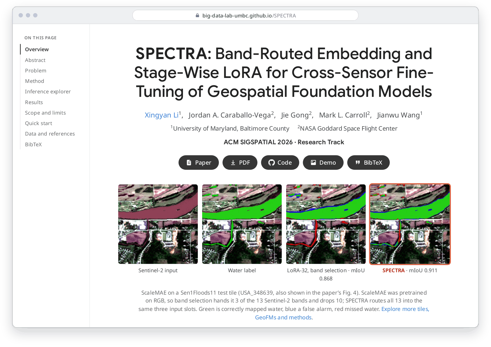
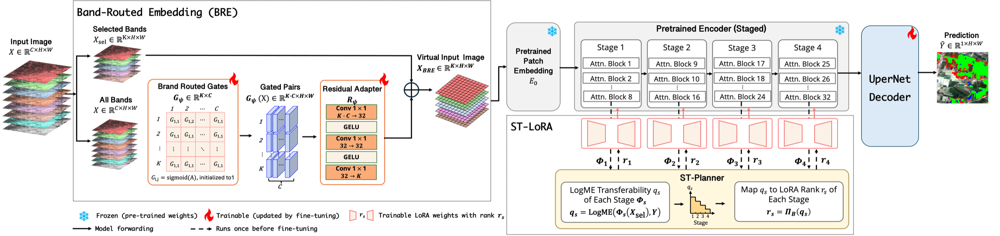

<h1 align="center">SPECTRA</h1>

<p align="center">
  <b>SPECTRA: Band-Routed Embedding and Stage-Wise LoRA for Cross-Sensor Fine-Tuning of Geospatial Foundation Models</b>
</p>

<p align="center">
  Xingyan Li<sup>1</sup>, Jordan A. Caraballo-Vega<sup>2</sup>, Jie Gong<sup>2</sup>, Mark L. Carroll<sup>2</sup>, Jianwu Wang<sup>1</sup><br>
  <sup>1</sup>University of Maryland, Baltimore County &nbsp; <sup>2</sup>NASA Goddard Space Flight Center
</p>

<p align="center">
  ACM SIGSPATIAL 2026, Research Track<br>
  <a href="https://arxiv.org/abs/2608.01751">Paper (arXiv:2608.01751)</a> &nbsp;|&nbsp;
  <a href="https://doi.org/10.1145/3841645.3842981">DOI 10.1145/3841645.3842981</a>
</p>

<p align="center">
  <a href="https://big-data-lab-umbc.github.io/SPECTRA/"></a>
</p>

<p align="center">
  <a href="https://big-data-lab-umbc.github.io/SPECTRA/"></a>
</p>

This repository contains the implementation of **SPECTRA**, a parameter-efficient
fine-tuning framework for segmentation with EO-pretrained geospatial foundation
models (GeoFMs) whose pretrained band interface does not match the downstream sensor.

SPECTRA combines:

1. **BRE**: Band-Routed Embedding. BRE keeps the pretrained patch embedding
   frozen, selects pretrained-compatible target bands, and learns a
   zero-initialized residual correction from all available source bands.
2. **ST-LoRA**: Stage-wise Transferability-aware LoRA. The **STPlanner** profiles
   stage-wise transferability and chooses per-stage LoRA ranks under a LoRA rank
   budget. Both `transfer` and `repair` planning modes are included.



The public training CLI exposes only the methods used for the main comparison
table:

- `lp`
- `lora8`, `lora16`, `lora32`, `lora64`
- `last_stage`
- `surgical`
- `full_ft`
- `spectra` = BRE + ST-LoRA

## Results

Test macro mIoU (%), mean ± standard deviation over seeds 42-44, from Table 4 of the paper.
LoRA-32 and Full-FT use band selection; Full-FT is a high-cost reference. Bold marks the
better of the two parameter-efficient methods.

| GeoFM | Dataset | LoRA-32 | Full-FT | SPECTRA | SPECTRA trainable params |
| --- | --- | ---: | ---: | ---: | ---: |
| Prithvi-EO-2.0 600M | Sen1Floods11 | 85.10 ± 1.70 | 86.24 ± 2.95 | **86.39 ± 0.85** | 4.06% |
| Prithvi-EO-2.0 600M | FireScars | **85.47 ± 0.35** | 87.71 ± 1.13 | 85.40 ± 0.33 | 5.31% |
| Prithvi-EO-2.0 600M | Landslide4Sense | 77.07 ± 0.05 | 77.25 ± 0.08 | **77.28 ± 0.09** | 3.29% |
| Prithvi-EO-2.0 600M | SA Crop Type | 35.61 ± 0.56 | 37.63 ± 1.01 | **36.32 ± 0.63** | 5.31% |
| ScaleMAE | Sen1Floods11 | 77.07 ± 2.05 | 75.41 ± 0.99 | **85.45 ± 2.08** | 7.23% |
| ScaleMAE | FireScars | 68.20 ± 1.89 | 72.30 ± 1.39 | **82.05 ± 2.07** | 7.48% |
| ScaleMAE | Landslide4Sense | 75.16 ± 0.28 | 75.36 ± 0.07 | **76.33 ± 0.06** | 6.20% |
| ScaleMAE | SA Crop Type | 31.90 ± 0.34 | 33.22 ± 0.52 | **31.97 ± 0.30** | 7.56% |
| SatMAE | Sen1Floods11 | 84.95 ± 1.82 | 85.94 ± 2.08 | **87.19 ± 0.82** | 6.49% |
| SatMAE | FireScars | 64.97 ± 0.30 | 71.61 ± 0.71 | **68.37 ± 1.53** | 7.73% |
| SatMAE | Landslide4Sense | 77.56 ± 0.16 | 77.26 ± 0.13 | **78.26 ± 0.13** | 6.36% |
| SatMAE | SA Crop Type | 32.77 ± 0.41 | 33.30 ± 1.12 | **33.39 ± 0.47** | 7.73% |

SPECTRA trains 3.29-7.73% of the parameters. Across five fine-tuning policies and 60 matched
configurations, replacing band selection with BRE raises mean macro mIoU by +2.88 points.
Gains are largest where band selection discards many downstream bands (ScaleMAE) and small
where the bands already match (Prithvi-EO-2.0 on FireScars). The paper and the
[project page](https://big-data-lab-umbc.github.io/SPECTRA/) have the full comparison,
including LP, LoRA-16/64 and surgical fine-tuning.

## Installation

```bash
pip install -e .
```

Backbone-specific dependencies such as TerraTorch/Prithvi should be installed
in the active environment. If they are local checkouts, point the runner to
them with:

```bash
export TERRATORCH_ROOT=/path/to/terratorch
export PRITHVI_EO_ROOT=/path/to/Prithvi-EO-2.0
```

For a source checkout setup:

```bash
git clone https://github.com/torchgeo/terratorch /path/to/terratorch
git clone https://github.com/NASA-IMPACT/Prithvi-EO-2.0 /path/to/Prithvi-EO-2.0
```

## Dataset roots

Set dataset roots with environment variables. No private paths are hard-coded.

```bash
export SPECTRA_FIRE_SCARS_ROOT=/path/to/hls_burn_scars
export SPECTRA_SEN1FLOODS11_ROOT=/path/to/sen1floods11
export SPECTRA_LANDSLIDE4SENSE_ROOT=/path/to/Landslide4Sense
export SPECTRA_GEOBENCH_SA_CROP_TYPE_ROOT=/path/to/Geobench_SA_crop_type
```

Download the datasets from their upstream sources, then set the environment
variables above to the local directories with the expected layout.

| Dataset | Upstream source | Example download/setup |
| --- | --- | --- |
| FireScars / HLS Burn Scar Scenes | https://huggingface.co/datasets/ibm-nasa-geospatial/hls_burn_scars | `huggingface-cli download --repo-type dataset ibm-nasa-geospatial/hls_burn_scars --local-dir /path/to/hls_burn_scars`; extract the downloaded archive so `/path/to/hls_burn_scars/training` contains `*_merged.tif` images and matching `*.mask.tif` masks. |
| Sen1Floods11 | https://github.com/cloudtostreet/Sen1Floods11 | `gsutil -m rsync -r gs://sen1floods11 /path/to/sen1floods11`; SPECTRA reads the hand-labeled Sentinel-2 split under `v1.1/data/flood_events/HandLabeled`. |
| Landslide4Sense | https://www.iarai.ac.at/landslide4sense and https://huggingface.co/datasets/ibm-nasa-geospatial/Landslide4sense | Download from the IARAI challenge page or the Hugging Face mirror; SPECTRA expects `images/{train,validation,test}` and `annotations/{train,validation,test}` with HDF5 files. |
| GEO-Bench SA Crop Type | https://github.com/ServiceNow/geo-bench and https://huggingface.co/datasets/recursix/geo-bench-1.0 | Install GEO-Bench and run `GEO_BENCH_DIR=/path/to/geobench geobench-download`; set `SPECTRA_GEOBENCH_SA_CROP_TYPE_ROOT` to the extracted SA crop-type task directory containing `default_partition.json` and `data/*.hdf5`. |

## Training examples

LoRA32 baseline:

```bash
CUDA_VISIBLE_DEVICES=0 python scripts/finetune.py \
  --config configs/prithvi_sen1floods11.yaml \
  --method lora32 \
  --seed 42 \
  --split-seed 42 \
  --loss-mode ce_dice_dwa \
  --save-checkpoints
```

SPECTRA with STPlanner repair mode:

```bash
CUDA_VISIBLE_DEVICES=0 python scripts/finetune.py \
  --config configs/prithvi_sen1floods11.yaml \
  --method spectra \
  --st-planner repair \
  --seed 42 \
  --split-seed 42 \
  --loss-mode ce_dice_dwa \
  --save-checkpoints
```

SPECTRA with fixed CE/weighted CE + Dice1:

```bash
CUDA_VISIBLE_DEVICES=0 python scripts/finetune.py \
  --config configs/satmae_sen1floods11.yaml \
  --method spectra \
  --st-planner transfer \
  --loss-mode ce_dice \
  --dice-lambda 1.0 \
  --seed 42 \
  --split-seed 42 \
  --save-checkpoints
```

## Included experiment cells

Configs are provided for Prithvi-EO-2.0 600M, ScaleMAE, and SatMAE on:

- Sen1Floods11
- FireScars
- Landslide4Sense
- GEO-Bench SA Crop Type

For Prithvi + FireScars, where the target input bands already match the
pretrained 6-band patch embedding, `spectra` automatically bypasses BRE and
runs native patch embedding + ST-LoRA.

## Project page

The static project page lives in [`docs/`](docs/) and is served with GitHub Pages. To preview it
locally, serve the folder over HTTP (the inference explorer reads image pixels, which browsers
block for pages opened from disk):

```bash
cd docs && python3 -m http.server 8000
```

## Citation

```bibtex
@inproceedings{li2026spectra,
  title     = {SPECTRA: Band-Routed Embedding and Stage-Wise LoRA for Cross-Sensor Fine-Tuning of Geospatial Foundation Models},
  author    = {Li, Xingyan and Caraballo-Vega, Jordan A. and Gong, Jie and Carroll, Mark L. and Wang, Jianwu},
  booktitle = {The 34th ACM International Conference on Advances in Geographic Information Systems (SIGSPATIAL '26)},
  year      = {2026},
  address   = {Riverside, CA, USA},
  publisher = {ACM},
  doi       = {10.1145/3841645.3842981},
  eprint    = {2608.01751},
  archivePrefix = {arXiv}
}
```

## References

SPECTRA reuses public backbone, decoder, and adaptation implementations instead
of vendoring them into this repository.

| Component | Upstream reference | Used in SPECTRA |
| --- | --- | --- |
| TerraTorch framework | https://github.com/torchgeo/terratorch | Prithvi segmentation task and shared UPerNet decoder dependency |
| Prithvi-EO-2.0 release | https://github.com/NASA-IMPACT/Prithvi-EO-2.0 | `prithvi_eo_v2_600` configs |
| Prithvi-EO-2.0 600M weights | https://huggingface.co/ibm-nasa-geospatial/Prithvi-EO-2.0-600M | Pretrained Prithvi checkpoint used by the TerraTorch task |
| TerraTorch segmentation task | https://github.com/torchgeo/terratorch/blob/main/terratorch/tasks/segmentation_tasks.py | Prithvi backbone implementation path in `scripts/finetune.py` and `scripts/timing_pass.py` |
| TerraTorch UPerNet decoder | https://github.com/torchgeo/terratorch/blob/main/terratorch/models/decoders/upernet_decoder.py | Dense prediction heads for SatMAE and ScaleMAE wrappers |
| SatMAE official code | https://github.com/sustainlab-group/SatMAE | `satmae_sentinel_vitl` wrapper in `spectra/backbone/satmae.py` |
| TorchGeo Scale-MAE | https://github.com/torchgeo/torchgeo/blob/main/torchgeo/models/scale_mae.py | `scalemae_fmow_rgb` wrapper in `spectra/backbone/scalemae.py` |
| LoRA reference implementation | https://github.com/microsoft/LoRA | LoRA adaptation design reference for `spectra/adapter/nested_lora.py` |
| LogME reference implementation | https://github.com/thuml/LogME | Transferability scoring reference for `spectra/planner/logme_profiler.py` |

## License

Released under the [MIT License](LICENSE).
